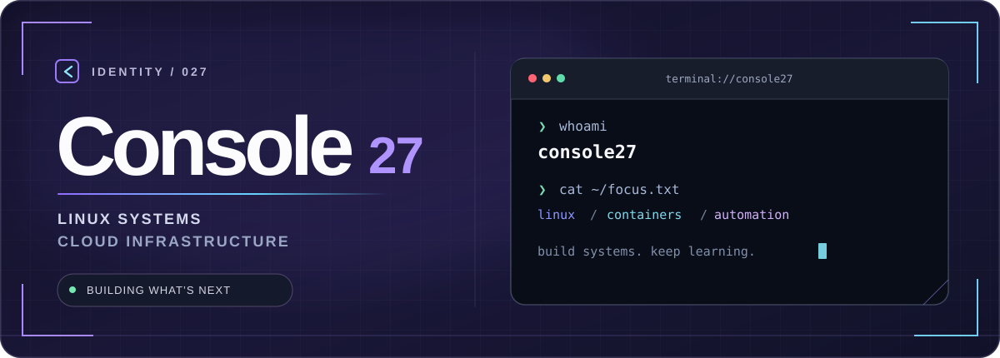
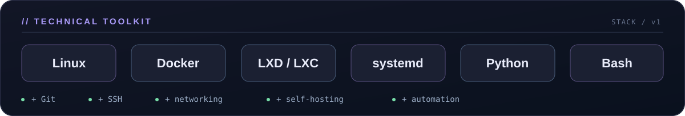
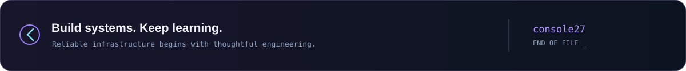

<!--
  console27 / GitHub Profile
  Designed as a native GitHub README with local SVG assets.
  No remote image services, fabricated metrics, JavaScript, or CSS required.
-->

<div align="center">
  
</div>

<br />

### `01` &nbsp; / &nbsp; WHO AM I

I'm **Console**, a **Linux Administrator** focused on **systems engineering, cloud infrastructure, and automation**. I enjoy turning complex technical challenges into reliable, practical tools.

I'm starting fresh with larger, long-term projects built around useful infrastructure, thoughtful design, and maintainable systems.

```text
console27@linux:~$ cat priorities.txt
> Build useful infrastructure.
> Automate the repetitive work.
> Keep systems secure, clear, and maintainable.
```

### `02` &nbsp; / &nbsp; TECHNICAL TOOLKIT

<div align="center">
  
</div>

My core interests are **Linux server administration**, **container-based virtualization**, **VPS infrastructure**, **deployment workflows**, and **self-hosted platforms**.

### `03` &nbsp; / &nbsp; HOW I THINK

> **Good infrastructure is invisible when it works and understandable when it doesn't.**

I enjoy learning through real deployments, reading logs, debugging edge cases, and improving systems one iteration at a time.

<details>
<summary><strong>Open the operator notes</strong> &nbsp; ↗</summary>
<br />

```yaml
identity: console27
role: Linux Administrator
interests:
  - Linux and server operations
  - Cloud and VPS infrastructure
  - LXD/LXC and Docker
  - Self-hosting and automation
direction: larger-scale, long-term projects
approach: build -> test -> improve
```

</details>

<br />

<div align="center">
  <a href="https://github.com/console27?tab=repositories"></a>
</div>

<br />

<div align="center">
  
</div>
